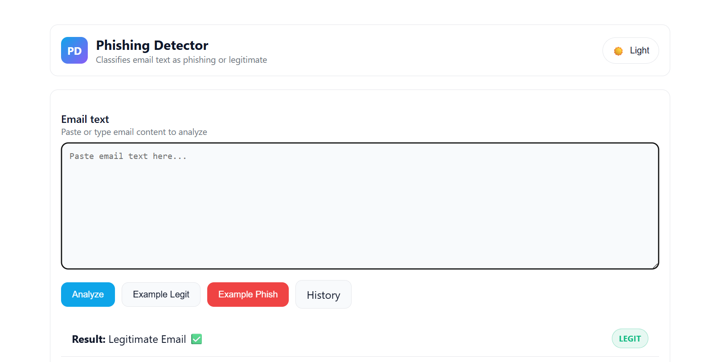

# Phishing Email Detector (Flask)

A simple, friendly web app that helps you spot phishing emails fast. Paste email text, hit Analyze, and get a clear verdict with a probability bar, helpful highlights, and a clean UI with light/dark mode.



## ✨ What you can do here
- **Real‑time check**: Paste email content and see if it's phishing or legitimate
- **Confidence at a glance**: Visual probability bar for phishing likelihood
- **Smart hints**: Suspicious terms and informative tokens highlighted
- **Dark/Light mode**: One‑click theme toggle that remembers your choice
- **History**: See your past analyses at `/history`
- **JSON API**: `POST /api/predict` for programmatic use

## 🚀 Quick start
1. Install dependencies (ideally in a virtual environment):
```bash
pip install -r requirements.txt
```
2. Train the model (creates `model.pkl` and `vectorizer.pkl`):
```bash
python train_model.py
```
3. Run the app:
```bash
python app.py
```
4. Open your browser: `http://127.0.0.1:5000/`

## 🧠 How it works
- Text is vectorized using TF‑IDF
- A Random Forest model predicts phishing vs. legitimate
- We surface helpful context like suspicious keywords and informative tokens present in your text


## 📄 Dataset (emails.csv)
- CSV with two columns: `email_text` (string) and `label` (`1` = phishing, `0` = legit)
- Have included a variety of realistic samples and expanded the file for better coverage
- You can keep adding rows to improve the model—then re‑run `python train_model.py`

## 🔌 API usage
- Endpoint: `POST /api/predict`
- Request JSON:
```json
{ "email": "Your account has been suspended. Click here to verify..." }
```
- Response JSON:
```json
{
  "label": "phishing",
  "probability": 0.82,
  "top_tokens": ["verify", "account"],
  "suspicious_hits": ["verify", "account", "click"]
}
```

## 🛠️ Customize the model
Open `train_model.py` to tweak:
- TF‑IDF settings: `stop_words`, `max_df`, etc.
- Classifier: RandomForest parameters like `n_estimators`
- Split size: `test_size`


## 🔒 Notes
This app is for educational/demo use. It can help flag suspicious emails, but it isn’t a replacement for professional security tools or judgement.


Have ideas for improvements (e.g., `.eml` upload, bulk CSV analysis, or exporting history)? Open an issue or ping me—happy to help!
